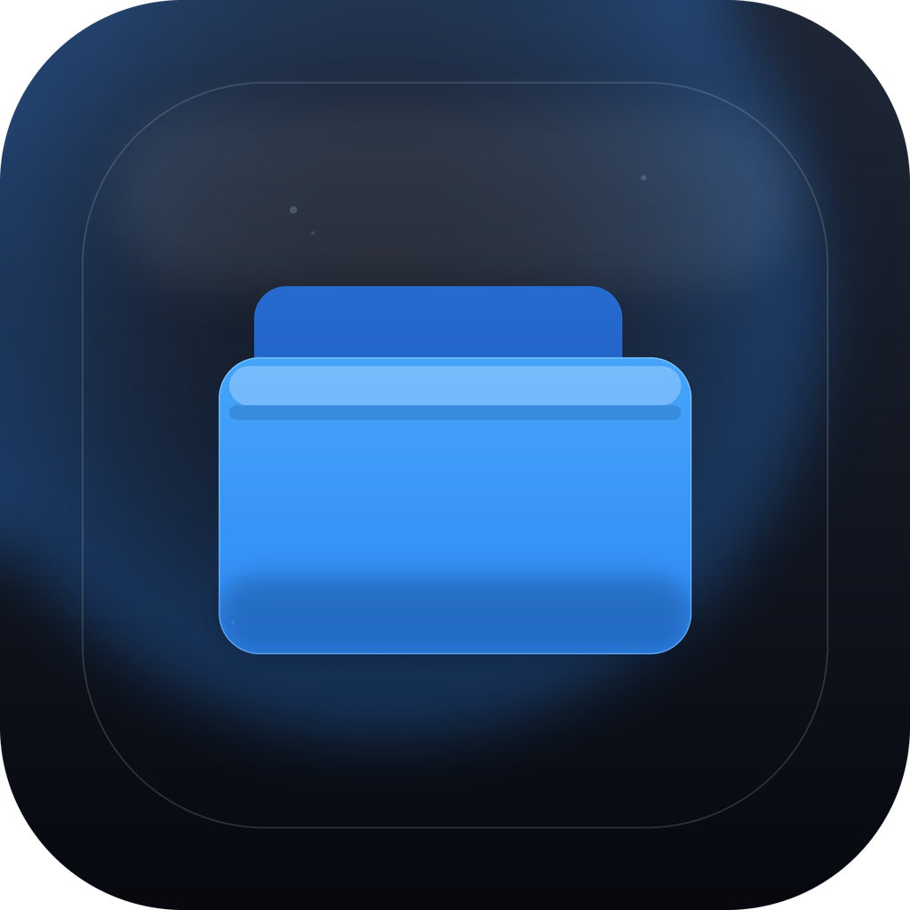

  

<h1 align="center">FileGent</h1>

macOS 原生文件管理器：多窗格、多标签页、四种外观，一切都在本机。

  
  
  

> 本仓库仅用于产品展示与问题反馈，**不包含源代码**（闭源软件）。

---

## 是什么

FileGent 是一个 macOS 原生文件管理器，Swift + AppKit 写的，不依赖任何第三方库。它治的是 Finder 的两个老毛病：**要并排看两个目录就得开两个窗口**、**想换个整齐的布局没地方换**。

FileGent 把目录浏览做成「窗格 + 标签页」两层：一个窗口里最多放 4 个窗格，每个窗格自己带一排标签页，拖拽换位、重启后恢复；外观有四种，从纯黑到浅色各有各的用法。

## 界面

**四种外观**
- 纯黑（默认）：低亮度环境下最舒服，长时间盯着不刺眼
- 炫彩：侧栏与强调色更饱和，适合当桌面窗口摆着看
- 白色薄纱玻璃：半透明材质，底下内容隐约可见
- 浅色：白天与投屏时用

侧栏、检查器、列表文字会跟着外观一起换，不会出现「深色面板配浅色字」的割裂感。

**窗格布局**
- 单窗格 / 双窗格 / 三窗格（三列）/ 四窗格（2×2 井字），`⌃1`–`⌃4` 直接切
- 窗格配色 6 套可自选，可以逐窗格设强调色，四个窗格一眼分清谁是谁
- 分隔条可拖动，比例会记住

**标签页**
- 每个窗格独立一排标签，新建 / 切换 / 关闭、拖拽换位
- 主窗口重启后恢复各窗格的标签与当前目录

## 功能

- **压缩包浏览**：双击 `.zip` / `.tar` / `.tar.gz` 等归档直接进只读浏览窗口，能进子目录；双击里面的文件按需解压后打开，也支持「解压全部…」。不用先解压一层到桌面。
- **检查器**：概览（名称、路径、大小、类型）、时间（创建 / 修改 / 访问）、文件夹内容速览（最近修改 5 项）、文件中转站。
- **文件夹大小**：后台递归统计，`du` 兜底，修掉了部分目录显示 0 KB 的老问题；大小列可排序。
- **文件操作**：收藏、置顶、锁定（防误删）、废纸篓还原与清空、批量重命名、新建文件夹 / 空文件。
- **窗口**：顶部动作条一键切外观 / 窗格 / 配色 / 隐藏文件 / 侧栏 / 检查器；「恢复所有窗口尺寸」把散落的窗口拉回原尺寸；「在新窗口中打开」沿用当前窗格排布并向右下错开。
- **入口**：网络与云盘在侧栏有固定入口，常见目录（下载、文稿、桌面、应用程序）直接进。

## 快捷键

| 操作 | 快捷键 |
|---|---|
| 新建标签页 | `⌘T` |
| 关闭标签页 | `⇧⌘W` |
| 新建文件夹 | `⇧⌘N` |
| 新建空文件 | `⌘N` |
| 单 / 双 / 三 / 四窗格 | `⌃1` / `⌃2` / `⌃3` / `⌃4` |
| 切换外观 | `⇧⌘A` |
| 显示 / 隐藏文件 | `⇧⌘H` |
| 打开所选文件 | `⌘O` |
| 在新窗口中打开 | `⌘⌥O` |
| 恢复所有窗口尺寸 | 顶部动作条 ↺ 或「显示 → 恢复所有窗口尺寸」 |

## 截图

界面截图整理中。四种外观与 1–4 窗格的实际画面会补到 `screenshots/`。

## 系统要求

- macOS 14.0 或更高版本
- Apple Silicon（arm64）

## 版本

当前版本 **1.0.7（build 19）**，详见 [CHANGELOG.md](CHANGELOG.md)。

## 下载

暂未提供公开下载（未做 Apple 公证，ad-hoc 签名分发）。如需试用或反馈问题，请在本仓库开 Issue。

> 未公证的包首次打开会被 Gatekeeper 拦：右键 App → 打开，或
> `xattr -dr com.apple.quarantine /Applications/FileGent.app`。

## 隐私

- 只读取本机文件系统的目录与文件元数据，用于展示与操作。
- **不联网**、不上传文件名或路径、不包含任何统计上报。
- 所有操作都是标准文件系统调用，不驻留后台进程、不注册系统扩展。

## 许可

Copyright (c) 2026 baikaylyn. All rights reserved. 详见 [LICENSE](LICENSE)。
